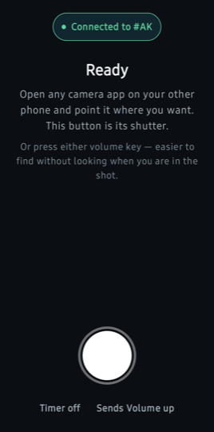
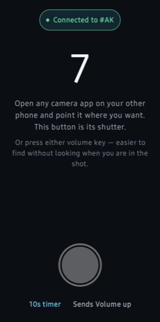

<div align="center">


# ShutterLink

**A Bluetooth shutter button for the phone across the room.**

Prop your other phone up, open any camera app on it, and take the photo from
the phone in your hand — with nothing installed on the camera phone at all.

</div>

<div align="center">


&nbsp;&nbsp;&nbsp;&nbsp;


</div>

## How it works

To your other phone, this is simply a Bluetooth keyboard — the same thing a
selfie remote pretends to be. That is why nothing has to be installed over
there, and why it works anywhere the two phones are in range.

1. **Open ShutterLink** on the phone you will hold, and tap *Make this phone
   visible*.
2. **Pair with it from your other phone**, in that phone's ordinary Bluetooth
   settings, exactly as you would pair a remote.
3. **Open any camera app** on it, prop it up, and press the button — or either
   volume key.

After the first time there is no setup at all: open the app and it reconnects
on its own.

## What it does

- **Fires the shutter** on whatever camera app is open on the other phone, in a
  fraction of a second.
- **Either volume key works**, so you can take the photo without looking at the
  phone — which is the usual situation, since you are standing in the shot. The
  app only borrows those keys while it is connected.
- **Self-timer**, 3 or 10 seconds, counted down in your hand.
- **Picks the key it sends.** Volume up by default, because that is what camera
  apps expect. If yours wants a different one, change it in a tap.
- **Works with no network.** No Wi-Fi, no mobile data, no router, no account.
  Bluetooth between two phones is the whole of it.

## What it needs

| | |
|---|---|
| The phone in your hand | **Android 10 or newer**, able to act as a Bluetooth HID device. Most can; the app says so plainly if yours cannot. |
| The camera phone | **Anything with Bluetooth and a camera app.** No Android version requirement, because nothing of ours runs on it. |
| A network | **None.** |

## Permissions

Four, and all of them Bluetooth:

| Permission | Why |
|---|---|
| `BLUETOOTH_ADVERTISE` | So your other phone can find this one to pair with |
| `BLUETOOTH_CONNECT` | Sending the keystroke |
| `BLUETOOTH`, `BLUETOOTH_ADMIN` | The same two on Android 11 and below |

No camera, no location, no storage, no internet. The app holds no `INTERNET`
permission at all, and CI fails the build if one ever appears — see
[`SECURITY.md`](SECURITY.md).

## Building

No Android Studio required; the Gradle wrapper is checked in.

```bash
# JDK 21, and the Android SDK:
sdkmanager "platform-tools" "platforms;android-37.2" "build-tools;37.0.0"
echo "sdk.dir=$ANDROID_SDK_ROOT" > local.properties

./gradlew :app:testDebugUnitTest :app:assembleDebug
```

## Documentation

| | |
|---|---|
| [`docs/VERIFY.md`](docs/VERIFY.md) | What has been checked on real phones, and what has not |
| [`docs/FINDINGS.md`](docs/FINDINGS.md) | Hardware findings and measurements behind the design |
| [`CONTRIBUTING.md`](CONTRIBUTING.md) | Scope, house style, how to test, how releases work |
| [`SECURITY.md`](SECURITY.md) | The permission list, and what pairing does and does not protect |
| [`CHANGELOG.md`](CHANGELOG.md) | What changed, version by version |

## Licence

[MIT](LICENSE).
